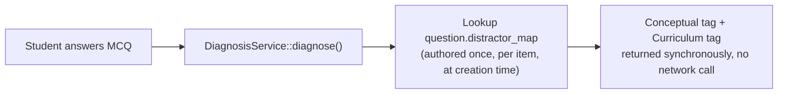
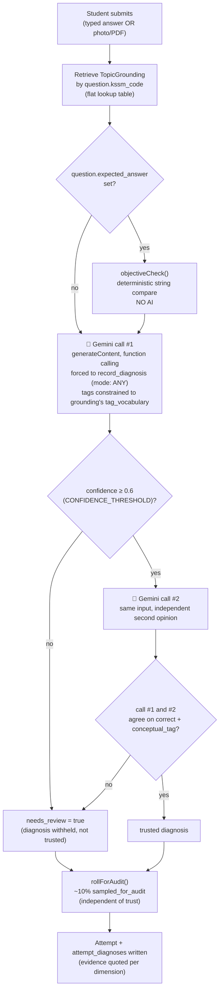
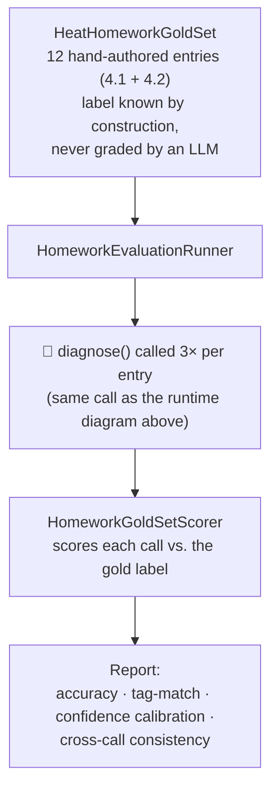

# AI Implementation — Current State

A visual companion to `engine.md` (design) and `architecture.md` (full system).
This file shows only the AI-calling parts of the pipeline and how they fit
together as of this session.

**Legend**: 🤖 = a real LLM call. Everything else on these diagrams is plain
PHP — no model involved. This is a fixed **workflow** (a predefined code path
that calls an LLM at set points), not an **agent** (a system where the model
itself decides what to do next) — see the note at the bottom.

## Quiz path — zero AI

The "intelligence" here was authored once by a human when the item was
written. Nothing is inferred by a model at answer time.

## Homework path — the only place AI runs at request time

Notes on this diagram:
- A **photographed/handwritten** answer follows the exact same shape — the
  only difference is call #1/#2's input is inline image/PDF data instead of
  a text prompt (`diagnosePhoto()`), and `objectiveCheck()` is skipped
  entirely (no transcribed text to compare).
- The self-consistency check (calls #1 vs #2) only compares **two calls
  within one submission**. It cannot catch the PNG-vs-PDF finding below,
  where two *separate* submissions of equivalent content disagreed with
  each other — each one individually passed its own internal check.
- Runs **synchronously, in-request** today (up to 2 Gemini calls) — not
  queued, despite `engine.md` §5 calling for this eventually.

## `homework:evaluate` — offline evaluation, not runtime AI

This is a dev-time CLI tool (`php artisan homework:evaluate`), not something
a student or teacher triggers. It exists to answer the question the runtime
pipeline can't answer about itself: *is this actually accurate, and
consistent across repeated submissions of the same content?* Built and
tested this session; **not yet run against the live API**.

## Why this is a workflow, not an agent

| | This system | An agent |
|---|---|---|
| Who decides the next step | Fixed PHP code (`HomeworkDiagnosisService`) | The model itself |
| Number/order of LLM calls | Always the same fixed sequence | Decided dynamically, call to call |
| "Function calling" use | Forces one schema for structured output | Model chooses among tools, decides whether/when to call |
| Retrieval | Flat lookup by `kssm_code`, always the same | Could dynamically decide what context to fetch |
| Memory across steps | None — one submission, one fixed pass | Can maintain state, loop, re-plan |

Every run of the homework path takes the identical shape regardless of
input — that's a deliberate property (auditability, cost, latency), not a
current limitation to fix. See the "AI Agent" discussion earlier in this
project's conversation history for the fuller reasoning on why an agentic
redesign isn't recommended at this stage.
